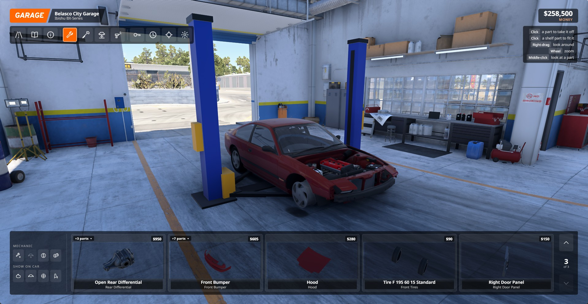
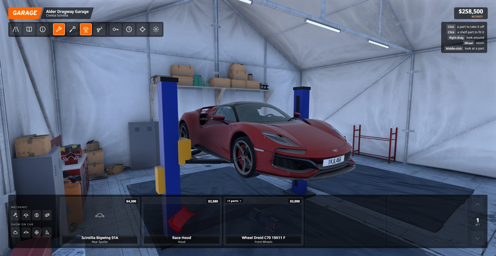

# BeamNG Wrench Works

A hands-on garage mod for BeamNG.drive.

A working garage for BeamNG.drive, built to feel like the one in *Street Legal Racing: Redline*. Roll up to a garage on West Coast USA or Utah, watch the car drive itself in onto the lift, then work on it by hand: click parts off, click them back on, tune, paint, repair, order new parts from the catalog, and drive out the other door.

It is a tribute to how that game's garage plays. Nothing from Street Legal Racing: Redline is used or included: all code here is written for BeamNG, and all models and textures come from BeamNG itself.

Built on BeamNG.drive 0.39.4.

## Getting it running

1. Download `wrench_works.zip` from the Releases page.
2. Drop it into your BeamNG mods folder (`%LOCALAPPDATA%\BeamNG\BeamNG.drive\current\mods`).
3. Load West Coast USA or Utah and drive into a garage doorway (orange marker) at walking pace. Faster than 15 km/h and you simply drive through; the limit is in Settings.

| Garage | Doors |
| --- | --- |
| Belasco City Garage (service station) | main door and side door: in by one, out by the other |
| Alder Dragway Garage | a tent with one entrance: drive in, and the car backs out |
| Industrial Garage | drive-through hall, either direction |
| Canyon Service Center (Utah) | one open bay: drive in, and the car backs out |

## Install and requirements

- **BeamNG.drive** 0.39.4 or newer, with the stock **West Coast USA** (garages and shops) or **Utah** map.
- **One zip, no unpacking:** `wrench_works.zip` is the garage on its own. For the career, take the bundle **Wrench Works Street Legal - West Coast** instead: it holds this garage, the career and the drivers, with each one's version checked against the others, so install that one *or* the single zips, not both.
- Optional: the **Wrench Works: Drivers & Pedestrians** mod (a driver behind the wheel, the arrival walk-round, outfits and helmets); [ffmpeg](https://ffmpeg.org) if you want to convert your own music for the radio.
- Remove an older copy of the mod from the mods folder before dropping in a new version.

Sounds are the game's own. A `.wav` dropped into `art/sound/slrr_garage/` under one of the names in `garage.lua` replaces the matching sound; `tools/install.ps1` can copy such a set from a Street Legal Racing: Redline install you own.

## With the career: Wrench Works Street Legal - West Coast

This garage is the one the **Wrench Works: Street Legal** career works in. Download **Wrench Works Street Legal - West Coast** to get this garage, the career and the drivers in one go, with each one's version checked against the others. The career pays for parts and services from its own money, adds a phone and laptops, and opens the garage when you walk or drive into a garage door.

The garage bar has: **Drive out**, **Catalog**, **Car info**, **Mechanic**, **Tune**, **Lift**, **Paint booth**, then the tabs the career fills: **Services** (oil, coolant, battery, nitrous, engine rebuild), **Races** (pick an event) and **Drivers** (who drives, their outfit, a helmet), then **Test engine**, **Whole car**, **Settings** and **Photo**.

- **Upgrades** (career only) lists what this garage can have: **lift**, **engine crane**, **workbench**, **dyno**, **paint booth**, **more shelves** and a **photo corner**. A new garage starts without them and the lift and the crane only stand in it once you buy them. Engine work needs the crane (a crude animation shows the engine rising out of the bay and going back in); underside work (gearbox, suspension, driveline, headers) needs the lift. The club garages come with the lift, the bench and the crane.
- **Leaving.** Besides **Drive out**: **Store this car** puts the car away and leaves you on foot (bring it or another car out again from the phone), **Walk out** leaves on foot and the car waits in the garage. Both work whatever car is on the lift.
- **The arrival.** When you park, the driver (Drivers & Pedestrians installed) gets out, walks round the car and shuts the door while the garage is already up and usable.
- **Tune** opens a panel with every tuning item of the car, grouped as the game's tuning menu groups them.
- **Paint booth**: three colours, finishes (gloss, satin, matte, metallic, pearl, chrome) and mixing sliders; **All three** sprays one paint everywhere. Colours are saved with the car.
- **Catalog**: hover a part to see what it does: an engine's power, torque, rev range and rated strength; springs, grip, brake torque and weight for the rest.
- **Photo** saves a picture of the car without the screen (to `screenshots/slrr_garage` in the game's user folder); **Showcase** turns the camera round it; **Photo mode** opens the game's own.

## The radio

Every garage has a radio, and it plays your music while you are in a garage or a shop, one track after another in a shuffled order. With "Music comes from the radio" switched on (it is by default) the sound has a place in the room: it is louder near the radio and moves between your ears as the camera goes round the car.

No music comes with the mod. Bring your own:

- **Files you already have as `.ogg`, `.wav` or `.flac`:** put them in `settings\slrr_garage\music` in your BeamNG user folder (`%LOCALAPPDATA%\BeamNG\BeamNG.drive\current`). Make the folder if it is not there.
- **Anything else (mp3, m4a, ...):** `add_music.ps1` (in `tools/`, and on the Releases page) converts it and puts it in that folder: `.\add_music.ps1 -Source "D:\Music\Garage"`. It needs [ffmpeg](https://ffmpeg.org) (`winget install Gyan.FFmpeg`).
- **The garage music of Street Legal Racing: Redline:** if you own the game, `.\add_music.ps1 -Slrr` finds your copy through Steam and converts its garage tracks. They are not included here because they are not ours to hand out.

`add_music.ps1` makes the tracks mono, which the game needs to place a sound in the room, and gives them the narrow tone of a small speaker. `-Clean` keeps them as they are, in stereo; those play as plain music.

**In the car**: the same music plays on the car radio while you drive. Every subfolder of the music folder is a station (`music\Rock`, `music\SLRR`...); the tracks lying loose in it are "Wrench Works FM". Bind a key to "Wrench Works: radio on/off" and "Wrench Works: next radio station" under Options > Controls. Each car keeps its station; the radio holds while the game is paused and makes way for the garage's radio.

Settings has a switch for the music, one for the radio effect, and a volume, and the car radio's switch and volume. Streaming services such as YouTube Music are not supported: the game can only play sound files.

## In the garage

| Do this | To get this |
| --- | --- |
| Click a part on the car | It comes off and lands on the shelf at the bottom, with everything bolted to it |
| Click a part on the shelf | It goes back on. If something is already in that slot, the two swap |
| Click the "+3 parts" tag on a shelf part | A list of what is bolted to it |
| Right-drag | Orbit the camera |
| Mouse wheel | Zoom |
| Middle-click a part | Look at that part |
| Mouse wheel over the shelf | Move the shelf a line up or down |

Every part comes off except the body shell itself. Take off what you like and drive out without it.

The icon bar along the top:

- **Drive out** – shows the job sheet (what was fitted, taken off and spent this visit), then builds the car as you left it and drives it out of the other door.
- **Catalog** – every part that fits the car, in five sections (Engine, Body, Running Gear, Interior, Paint) split into small chapters such as Front Bumpers, Rear Suspension or Front Tyres. The search box looks through the chapter you are in (an **All chapters** switch widens it to every chapter), wheel chapters have size and width buttons, the list can be sorted by price, and the mouse wheel turns the page. A chapter that holds parts for several slots gets a filter for each, named the way the car (or the mod the part comes from) names them. Parts go on a shopping list; you pay when you confirm it, and they are delivered to the shelf (see below).
- **Car info** – specs, part count and value, damage and repair cost, the engine's power and torque curve, and your saved builds.
- **Mechanic (wrench)** – the default mode: fit and remove parts.
- **Tune (screwdriver)** – click a door, hood or boot to open it; click any other part and it is outlined and a small panel pops up with just that part's adjustments (tyre pressure for a tyre, camber for the suspension, and so on). The full list is in the drawer on the right. Adjustments take effect when you drive out.
- **Lift** – a two-post lift (in a career you buy it under Upgrades; outside one every garage has it). The car parks between its posts, the arms swing in under the sills, and this button carries the car about 1.3 m up, camera and all.
- **Paint booth** – factory colours or mix your own, three colour slots. The car disappears in a cloud of the new colour while it is sprayed.
- **Test engine**, **Advance time**, **Whole car** (camera reset) and **Settings**.

The mechanic's buttons sit left of the shelf: **Repair part**, **Repair car**, **Sell part** (click a part on the shelf, or one on the car to take it off and sell it in one go; the price is shown first), **Sell everything** (asks first), and four toggles that hide the engine, body, running gear or interior so you can reach what is behind them.

With more than one newly bought part on the shelf, a **Fit all new parts** button appears above it. It fits them in order, a part before whatever bolts to it.

## Parts with options

Some parts are really a set of choices. A drag wheel from a wheel mod, say, wants a diameter, then a width, then a style, then extras. For such a part **Add** opens a list of everything it lets you choose, level by level, with what each choice adds to the price. What you leave alone comes as standard. The part then arrives as one item on the shelf, built the way you ordered it, and fits with one click. "Add as standard" skips the choosing.

## Starting from a body shell

Walk into a garage on foot and the lift is empty. Any car you have installed can be bought there as a bare body shell, at a fifth of its list price by default: it is put on the lift with everything that unbolts left off, and from there it is yours to build from the catalog. A shell that cannot move by itself is put outside the door when you leave. This is not available in career mode, where cars come from the dealership.

## Saved builds

In Car info, "Save the car as it stands" stores the parts and tuning that are on the car now under a name. Fitting a build later puts those parts back: from the shelf where you still have them, bought where you do not (the list shows what that would cost). What comes off goes to the shelf.

## Ordering parts, delivery and shops

- **Shopping list.** "Add" in the catalog puts a part on the list. Nothing is paid until you press Confirm purchase.
- **Delivery.** Parts ordered from the garage are delivered, and delivery is charged by weight and bulk: a hood costs many times what a mirror or a hub cap does. Standard delivery takes a few minutes; express costs more and arrives ten times sooner. Arrivals drop onto the shelf while you are in the garage, or are waiting there next time; out on the road a message tells you when an order has arrived.
- **Shops in town.** Seven businesses on West Coast USA sell parts over the counter. Stop on the blue marker on their forecourt. You either take the parts with you (they are on the shelf when you reach the garage) or choose **Fit them here**: they are fitted on the car you drove in for a labour charge (12 % of the part price, at least $8 a part), except at the used-parts yard, there is no delivery charge, and prices are 5% lower.

| Shop | Sells |
| --- | --- |
| Torres Tires | wheels, tyres, hubs |
| Belasco City Exhaust | exhausts and intakes |
| Fast Automotive | engines, turbos, nitrous, gearboxes, cooling, differentials |
| Smash Auto Repairs | body panels, lights, glass, spoilers, body kits |
| Jerry Riggs | suspension, brakes, steering, chassis bracing |
| Belasco Auto | interiors, trim, paint designs, accessories |
| Rent-A-Box Lock-up Sale | used parts of every kind: a pick that changes daily, 35-65% under list price, and bent. The dent goes on when the car is next built and can be repaired like any damage |

Delivery times (standard and express), delivery charges, the express surcharge and the shop discount can all be changed under Delivery in Settings.

## Part previews

The parts in the catalog and on the shelf are the real 3D models, with the game's own textures, your paint and your livery, turning at the game's frame rate. They are held in front of the camera, so on the shelf they step aside while the camera is moving and come back when it rests.

## Damage and money

- Parts keep their damage. Take a bent bumper off and it is still bent when you refit it, and the car leaves as damaged as it arrived, visit after visit, unless you pay to repair it.
- In career mode the garage spends and earns your career money. Outside it you have a wallet of your own that goes down when you buy and up when you sell, and is remembered between sessions. Settings has the starting amount and an unlimited-money switch.
- The Settings screen covers prices, sell-back value and repair cost, delivery times and charges, the entry speed, how fast the car drives itself in, the lift height, whether the driver's door opens on arrival, markers, shops, the controls reminder, camera direction and sensitivity, and preview speed and direction.

## Why working on the car does not stutter

Changing a part in BeamNG normally rebuilds the whole vehicle, which freezes the game for about a second. Here the car is not rebuilt while you work:

- taking a part off or refitting it only switches its meshes off and on;
- a part the car was not built with, such as one you just bought, is shown as its model placed on the car where it belongs;
- tuning changes are just noted;
- the one real rebuild happens when you drive out, behind the fade. Repairs are the exception: they rebuild the car on the spot.

## Graphics (optional)

Options > **Graphics** (the game's own options page, a group called "Wrench Works: anti-aliasing and sharpening" under the anti-aliasing type; the first start after installing needs a game restart to show it). All "Game's own" / off by default and switched live. The settings are saved with the game's other settings. Each choice has a note under it saying what it does and what it is for. A **Preset** (Balanced, Smooth, Maximum) picks the rest in one go.

- **Anti-aliasing:** Game's own, Off, FXAA, **FXAA HQ** (NVIDIA FXAA 3.11, sub-pixel removal at maximum), SMAA High, **SMAA Ultra** (our own copies of the edge and blending shaders with the Ultra preset, colour edges and optional **depth predication**), and **SMAA Ultra + Temporal smoothing**. While one of ours is picked it takes over Options > Graphics > Anti-aliasing; "Game's own" gives it back exactly as the game has it. Our shaders live in `shaders/common/postFx/slrrGfx/`; the game's own shader files and objects are never changed.
- **Temporal smoothing.** Blends the finished picture with the previous frame, found through the game's own motion-vector buffer and clamped to the surrounding colours so it does not ghost. It calms shimmer and crawling edges while you drive. It is not TAA: the engine has no camera jitter, so it cannot add detail and can soften the picture a little.
- **Sharpening:** AMD **CAS**, AMD **FSR 1 RCAS**, NVIDIA **NIS** sharpen, with a strength slider (0 to 1).
- **Not available in BeamNG mods** (and listed as such in the settings): NVIDIA DLSS, DLAA and Frame Generation; AMD FSR 2/3/4; the FSR 1 and NIS upscalers; TAA/TSR; MSAA; real supersampling. They need an SDK in the engine, a jittered camera or a render-scale setting, none of which the game exposes. For supersampling use NVIDIA DSR / AMD VSR in the driver and pick the bigger resolution in the game.

Our group is made by writing a copy of the game's options layout into your BeamNG user folder (`ui/ui-vue/src/modules/options/runtime/layout.json`); switching the mod off in the mod manager takes it out again. If the mod is removed some other way, delete that file (or run `require('slrr/graphics').uninstallOptions()` first) or the game keeps showing our controls. After a game update the copy is not refreshed from the new game layout until you do the same, so delete it then and restart.

Credits and licences (all MIT, kept in the shader headers): AMD FidelityFX CAS and FSR 1 RCAS (Copyright 2019-2021 Advanced Micro Devices, Inc.), NVIDIA Image Scaling NVSharpen (Copyright 2022 NVIDIA Corporation & Affiliates), SMAA (Jimenez et al., from the game's own copy), NVIDIA FXAA 3.11 (Timothy Lottes, from the game's own copy).

Frame cost: SMAA Ultra runs the same three passes as the game's SMAA with a longer search in two of them (plus a depth read with predication); Temporal smoothing is two more full-screen passes and a history texture; CAS and RCAS are one pass, NIS one pass with 25 reads. The exact cost depends on your card and resolution: switch them on and watch the frame time (the game's own frame-time display).

## Good to know

- The shelf (per car model), parts on order and your freeroam money are saved in `settings/slrr_garage/save.json` in your BeamNG user folder. "Keep parts and money between sessions" in Settings switches that off, so each time you start the game you begin from scratch.
- Two actions can be bound under Options > Controls > Gameplay: enter the nearest garage, and drive out. Handy when the car cannot drive itself to the door.
- Career mode: the garage spends your career money, and after the car is rebuilt on the way out it asks career to re-read the car, so career's record of it matches. Parts you take off live on this garage's shelf, not in career's own parts store.
- "Work takes time" in Settings makes taking parts off and fitting them take a moment, longer for heavy parts. It is off by default.
- **Adding garages and shops**, on any map, takes one console command where the point should be, or a small JSON file in a map mod. Existing points can be moved the same way. See [docs/adding_garages.md](docs/adding_garages.md).
- "Paper catalog" in Settings prints the catalog and the shops as a spiral-bound parts catalogue, in the spirit of the street racing games of the early 2000s. It is drawn from scratch; nothing from another game is used.
- **The driver**: with the Wrench Works: Drivers & Pedestrians mod installed, the garage's Services drawer lists its drivers; pick one to put them behind the wheel of the car on the lift. The change is announced as `onWrenchWorksDriverChanged(vehicleId, driverId)`.
- **For mod makers**, other mods can work with the garage (all GE Lua):
  - `onWrenchWorksServices(list, vehicleId)`: add entries to the garage's **Services** drawer, `{ id, label, desc, price, group, disabled }` (the price is only shown). A click comes back as `onWrenchWorksService(id, vehicleId)`. The drawer's button only shows when something is offered; Wrench Works offers nothing itself.
  - `onWrenchWorksPartBought(vehicleId, slotPath, part, price)`: once per part, after the checkout has paid (catalog or shop).
  - `onWrenchWorksDyno(vehicleId, data)`: the dyno sheet's figures when the car info screen measures the engine (`maxPower`, `maxTorque`, their rpm, the curves).
  - `onWrenchWorksDriveOut(vehicleId, data)`: when a car drives out of the garage, after it is rebuilt with what was done to it (`partsTree`: its final parts tree; `dents`: damage records left on it).
  - `onWrenchWorksPartSold(vehicleId, slotPath, part, price)`: once per part sold over the counter (the sell tool, the shelf, or sell all).
  - `slrr_garage.markJobCar(vehicleId[, false])`: a car that isn't the player's (a career's customer car or a wreck): parts taken off it sell for nothing.
  - `slrr_garage.addShelfPart(model, { part, name, slotId, value, wear })`: puts a part bought elsewhere (a career's used-parts market) on that model's shelf, no car needed. It shows as USED with its wear and sells back for half of what was paid.
  - `slrr_garage.shelfItems(model)`, `takeShelfItem(model, id)`, `putShelfItem(model, item)`: list a model's shelf, take an item off it (not while the garage is open) and put it back - for a career's market selling your parts.
  - `slrr_garage.garageAt(pos)` gives the id of the garage whose doors are within 50 m of a point (nil if none); `slrr_garage.enterWith(vehicleId, mode)` sends that car into its garage and opens it in `'catalog'`, `'tune'`, `'paint'` or `'repair'` (the repair tool) - for a career's computer. It returns `false` and a reason when the garage is busy or the car is not at a garage. Driving in by hand is unchanged.
  - `onWrenchWorksDamage(vehicleId, data)`: the dents of a car the garage measured (beams, nodes, latch states), to keep a car's damage your own way. `slrrGarageVeh.apply(data)` in the vehicle's Lua puts it back.
  - `require('slrr/garageParts').setMoneyProvider({ get = fn, add = fn(amount, label) })` makes the garage spend and earn your mod's money; `changeMoney(amount, label)` pays in or out from outside a garage visit.
- `docs/beamng_post.txt` is the forum post for the mod, in BBCode.
- `node tools/ui_selfcheck.js` runs the garage screen's logic (catalog search, sorting, paging, part options) outside the game.
- `tools/ingame_test.lua` runs the mod's features in the game itself and writes a pass/fail list; how to run it is at the top of the file.

## Source layout

| File | Job |
| --- | --- |
| `lua/ge/extensions/slrr/garage.lua` | state machine: door triggers, drive-in, garage, catalog, drive out, shop visits |
| `lua/ge/extensions/slrr/garageParts.lua` | parts tree, shelf, catalog, shopping list and deliveries, money, stand-in parts |
| `lua/ge/extensions/slrr/garagePicker.lua` | finds the part under the cursor |
| `lua/ge/extensions/slrr/garageCamera.lua` | drive-in, orbit and drive-out camera |
| `lua/ge/extensions/slrr/garageDamage.lua`, `lua/vehicle/extensions/slrrGarageVeh.lua` | damage that survives rebuilding the car, the lift |
| `lua/ge/extensions/slrr/garageShapes.lua` | cuts single parts out of the vehicle's model files |
| `lua/ge/extensions/slrr/garagePreview.lua` | shows those parts: turning previews and parts placed on the car |
| `lua/ge/extensions/slrr/garageLift.lua` | the car lift: its model and its movement |
| `lua/ge/extensions/slrr/garageSites.lua` | the garages and shops that come with the mod, and the reader for those added by files |
| `lua/ge/extensions/slrr/garageCatalog.lua`, `garageSettings.lua` | catalog chapters, settings |
| `lua/ge/extensions/slrr/garageMusic.lua` | the radio |
| `ui/modules/apps/slrrGarage/app.js` | the garage screen |

## Known issues

- The engine crane animation is a simple block on a sling; its position is the same for every car.
- Wheel size buttons only appear where the wheel parts carry a size in their name or id (for example 15x7 or 17 inch); other wheel chapters keep the slot filters.
- "Fit them here" fits every new, not yet fitted part on the shelf for that car, not only what was bought in that visit.
- The garage is in English; the texts are in `slrr/garageStrings.lua` and the screen's fallbacks if you want to translate them.
- Report anything else on the mod's page.

Not affiliated with BeamNG GmbH or the makers of Street Legal Racing: Redline.
